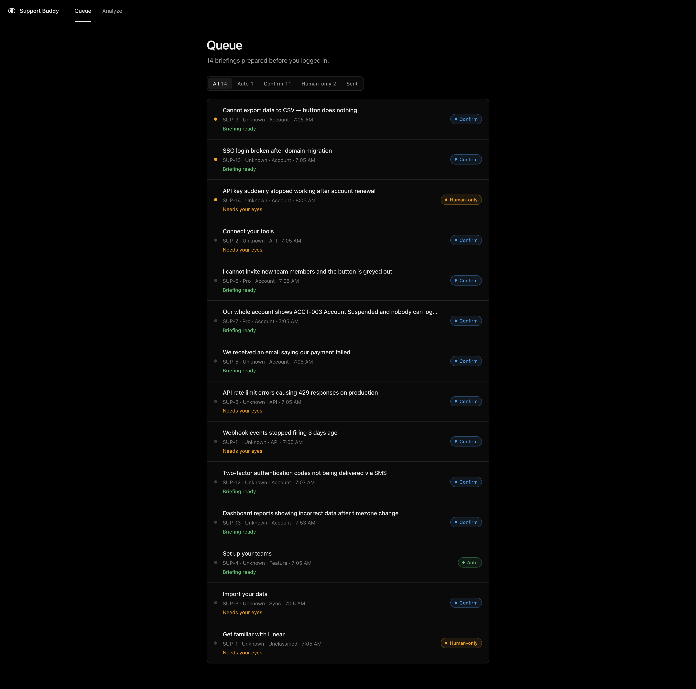
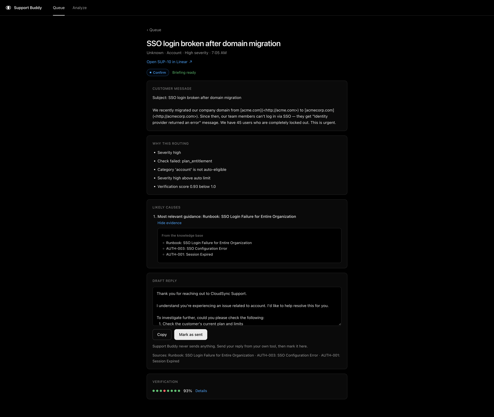
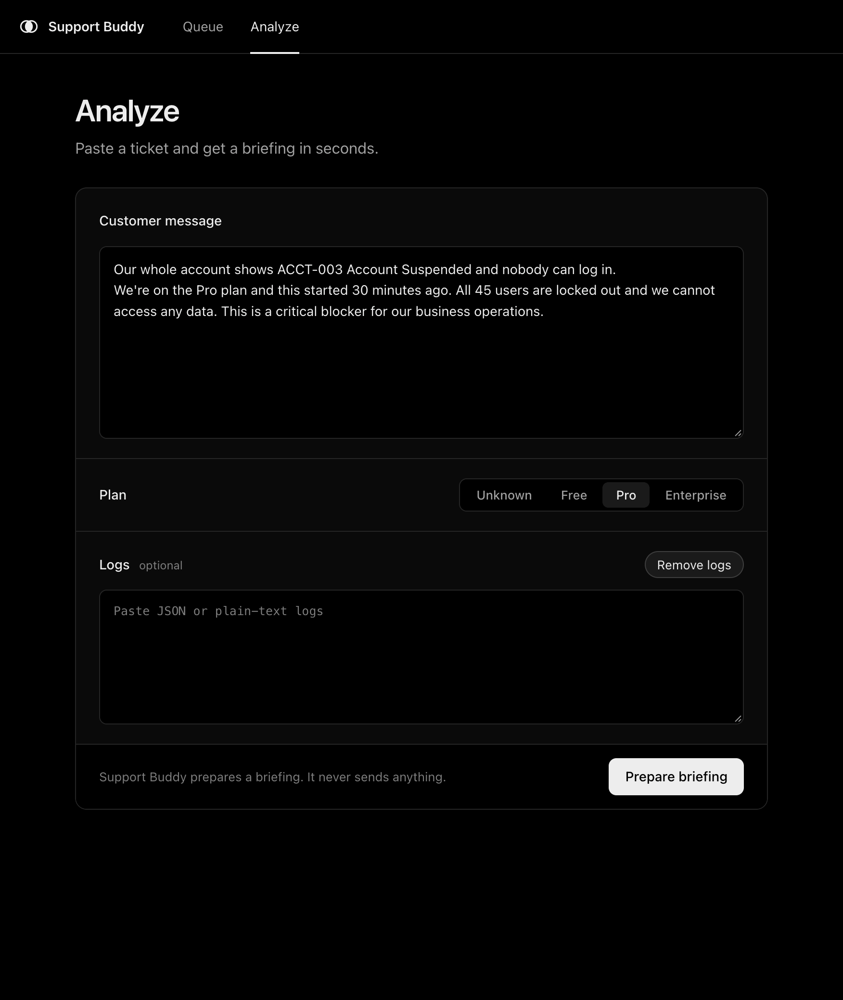

# Support Buddy

AI-powered internal support tool that helps Technical Support Engineers (TSEs) handle customer inquiries faster and more accurately. Connects to Linear to automatically prepare briefings before a TSE opens a ticket — so the analysis is ready the moment they need it.

Built with a virtual company scenario (CloudSync Inc.) for demo purposes, but designed to work with any team's documentation and workflow.

**Live demo → [support-buddy.pages.dev](https://support-buddy.pages.dev)**

<br/>

## Screenshots

### Queue

New tickets from Linear are automatically analysed and queued. Filter by autonomy level (Auto / Confirm / Human-only) or view sent replies.



### Briefing Detail

Each briefing shows the customer message, routing reason, likely causes with knowledge base evidence, a draft reply, and a trust verification score.



### Analyze

Paste any customer inquiry to generate a briefing on demand — no Linear ticket needed.



<br/>

## How it works

1. A background watcher polls Linear every 60 seconds for new tickets
2. Each ticket is classified (category, severity, autonomy level) using keyword analysis or Claude AI
3. A draft response is generated and verified against the knowledge base
4. The briefing appears in the Queue — ready before the TSE opens the ticket
5. The TSE reviews, edits, and sends — or escalates directly from the UI

<br/>

## Features

- **Live Queue** — briefings prepared automatically from Linear tickets, auto-refreshed every 30 seconds
- **Autonomy routing** — tickets are routed to Auto-send, Confirm, or Human-only based on policy rules and trust verification
- **Inquiry Analysis** — classify by category and severity with checklist, follow-up questions, and KB articles
- **Response Drafting** — AI-generated draft with confidence scoring and escalation flag
- **Trust Verification** — checks citations, log evidence, and customer plan before routing
- **PII Redaction** — emails, IPs, API keys stripped before any Claude call
- **Knowledge Engine** — semantic search over Markdown docs using ChromaDB vector embeddings
- **Linear Integration** — read-only polling; briefings link back to the originating ticket

<br/>

## Tech Stack

| Layer | Technology |
|-------|-----------|
| Language | Python 3.11+ |
| AI | Claude API (Anthropic SDK) |
| Knowledge Store | ChromaDB (vector embeddings) |
| Backend API | FastAPI on Fly.io |
| Frontend | React + TypeScript on Cloudflare Pages |
| Ticket source | Linear GraphQL API |
| Testing | pytest, pytest-asyncio |

<br/>

## Quick Start

### Prerequisites

- Python 3.11+
- Node.js 18+
- [uv](https://docs.astral.sh/uv/)

### Setup

```bash
git clone https://github.com/ella-yschoi/support-buddy.git
cd support-buddy

uv sync --extra dev --extra knowledge   # chromadb is an optional extra; tests need it

cp .env.example .env
# Add ANTHROPIC_API_KEY and LINEAR_API_KEY to .env
```

### Run the API server

```bash
uv run uvicorn src.api.server:app --reload
```

API docs at `http://localhost:8000/docs`.

### Run the web app

```bash
cd web && npm install && npm run dev      # http://localhost:5173
```

Without the API running it falls back to pre-computed demo briefings.

### Watch Linear for new tickets

```bash
# Poll once and exit
uv run python -m src.cli watch --source linear --once

# Keep polling every 60 seconds
uv run python -m src.cli watch --source linear --interval 60
```

Briefings appear in the Queue automatically. Customer plan is read from a `plan:<free|pro|enterprise>` label. Fenced code blocks in a ticket body are treated as log attachments.

### Run tests

```bash
uv run pytest tests/ -v
```

<br/>

## Project Structure

```
support-buddy/
├── src/
│   ├── core/
│   │   ├── briefing/      # Builder, store, watcher loop
│   │   ├── analyzer/      # Inquiry classification & log parsing
│   │   ├── knowledge/     # Vector store, document loading, search
│   │   ├── policy/        # Autonomy routing rules
│   │   ├── trust/         # Verification checks
│   │   └── pii/           # PII redactor
│   ├── integrations/
│   │   ├── linear/        # GraphQL client, write-back
│   │   └── tickets/       # Ticket source abstraction, cursor store
│   └── api/               # FastAPI routes
├── web/                   # React frontend (Cloudflare Pages)
├── data/
│   ├── knowledge/         # Domain knowledge documents (Markdown)
│   ├── policy/            # Autonomy policy YAML
│   └── virtual_company/   # Virtual company scenario data
├── tests/
├── Dockerfile             # API server + Linear watcher via start.sh
├── fly.toml               # Fly.io config (always-on, 1 GB)
└── pyproject.toml
```

<br/>

## Deployment

| Service | Platform | URL |
|---------|----------|-----|
| Frontend | Cloudflare Pages | [support-buddy.pages.dev](https://support-buddy.pages.dev) |
| API + Watcher | Fly.io (sjc) | support-buddy-api.fly.dev |

The Fly.io machine runs two processes via `start.sh`: the Linear watcher in the background and the FastAPI server in the foreground. `min_machines_running = 1` keeps the machine always on so the watcher is never suspended.

<br/>

## Environment Variables

| Variable | Required | Description |
|----------|----------|-------------|
| `ANTHROPIC_API_KEY` | No | Enables Claude AI analysis. Without it, keyword-based mode is used. |
| `LINEAR_API_KEY` | No | Polls Linear for new tickets |
| `API_SECRET_KEY` | No | Bearer token for API auth (leave empty for local dev) |
| `BRIEFING_DB_PATH` | No | SQLite path for briefings and cursors (default: `briefing_data/briefings.db`) |

<br/>

## License

This project is licensed under the [MIT License](LICENSE).
